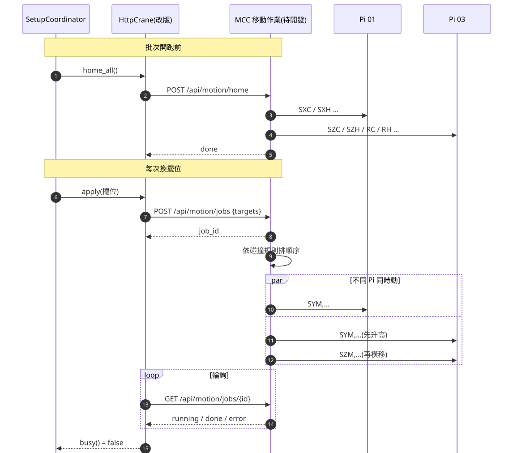

# 系統總覽:ACQUA 自動化 × 天車控制中心 × Pi 控制端

> 最後更新:2026-11-21
>
> 這份文件說明三個專案怎麼一起運作:各自負責什麼、資料怎麼流、彼此約定了什麼,
> 以及目前還有哪些問題和沒做完的部分。各專案的細節請看各自的 README。
>
> 圖的原始檔在 `docs/diagrams/*.mmd`(Mermaid),改完要重新產生 `.svg`,見 [docs/diagrams/README.md](docs/diagrams/README.md)。

| 專案 | 位置 | 一句話 |
|---|---|---|
| **ACQUA Automation** | 本資料夾 | 決定「這一筆測項要什麼擺位」,並驅動 ACQUA 量測 |
| **Motion Control Center(MCC)** | [frank931023/pc-led-controller](https://github.com/frank931023/pc-led-controller) | 管所有 Pi,把指令送到正確的 Pi,一台一次只跑一個指令 |
| **Pi 控制端** | [frank931023/pi-arduino-connection-test-0717](https://github.com/frank931023/pi-arduino-connection-test-0717) | 每台 Pi 上一份,把 HTTP 指令轉成 Serial 給 Arduino |

---

## 1. 全景圖



圖上沒畫的兩條次要連線:
- 人可以直接開 MCC 的網頁(`:5001`)手動操作機構。這時自動化送的指令會收到 `409`,見 §6 問題 8。
- 每台 Pi 上的 beszel-agent(選用)會主動把健康資料送到 Beszel hub。



**原則:每一層只跟相鄰的那一層講話。**
- ACQUA Automation 不直接連 Pi,一律經過 MCC。MCC 已經處理好裝置鎖、逾時和狀態判斷,重寫一份只會多一個要維護的地方。
- MCC 不懂 ACQUA,也不懂「擺位」,只懂裝置和韌體指令。
- Pi 不懂「軸屬於哪個總成」,只把字串原樣轉給 Arduino。

---

## 2. 各專案負責什麼

### 2.1 ACQUA Automation(本專案)

| 負責 | 不負責 |
|---|---|
| 用 COM 驅動 ACQUA,一筆一筆送測項(`StartSingleMeasurement`) | 寫入 ACQUA 的資料庫(一律唯讀,目前 0 筆寫入) |
| 從 SQL 讀專案樹、條件執行、測項的 `Setup` 標籤 | 編輯標籤(只能在 ACQUA 介面改) |
| 依 `Setup` 標籤決定這筆要哪個擺位,沒到位就先移動 | 機構怎麼安全地走到那裡(見 §7,建議交給 MCC) |
| 擺位存檔(`setups/*.json`,房間座標),在 3D 頁設計 | 韌體指令的細節 |
| 測試執行時依標籤自動套用擺位 | 看實機即時位置、手動推機構(屬於 MCC 的網頁) |
| 開跑前把測項依擺位分組,減少移動次數 | |
| 麥克風卡極化電壓(ACQUA 不碰這塊) | |
| 自動關掉 ACQUA 的彈窗(`winwatch`) | |

主要模組:

| 模組 | 角色 |
|---|---|
| `acqua/setuptags.py` | 純資料:讀標籤、資料夾繼承(同資料夾的兄弟測項)、開跑前檢查 |
| `acqua/setupcoord.py` | `SetupCoordinator`:標籤 → 擺位 → 叫機構移動,失敗不擋量測 |
| `acqua/roomsetups.py` | 擺位存檔,**用名稱對應** |
| `acqua/crane.py` | `CraneBridge`:`MockCrane`(模擬)/ `HttpCrane`(接 MCC),以及 19 根軸的定義 `AXES` |
| `acqua/labcore.py` | 麥克風卡供電 |
| `acqua_scripts/HOOK_setup_bridge.py` | 貼進 ACQUA 的掛鉤,讓「直接在 ACQUA 按開始」也會移機構 |


### 2.2 MCC(pc-led-controller)

- 裝置清單(`data/pi_config.json`):`pi_id` → host / port / 名稱 / 停車位置。
- 背景每 5 秒檢查每台 Pi 的狀態:`online` / `busy` / `no-arduino` / `offline`。**30 秒沒有任何 API 呼叫就暫停檢查。**
- **一台裝置一次只跑一個指令**,前一個沒結束就回 `409`。Pi 本身也會擋,所以從 Pi 本機網頁送的指令一樣擋得住。
- 指令逾時以 Pi 回報的值為準,自己再多等 5 秒。
- 指令表(按鈕、逾時、Home all 順序)來自每台 Pi 的 `/api/commands`。
- Beszel 健康監控(CPU、溫度、容器)和告警(webhook)。
- 用 Ansible 部署多台 Pi。

MCC 眼中一台裝置的狀態:



### 2.3 Pi 控制端(pi-arduino-connection-test-0717)

- 一台 Pi 接一片 Arduino。`.env` 裡的 `PI_ID`、`BOARD`(`mega` / `uno`)、序列埠、逾時,每台各自設定。
- 把指令補上換行寫進 Serial,一直讀到 `DONE` 或 `ERR` 為止。韌體穿插的心跳行(`HB,...`)在這裡就濾掉了。
- 在 `/api/status` 回報 `board`、`rig_name`、`command_timeout`、`max_command_timeout`、`app_version`。
- 也有本機網頁 `http://<Pi>:5000/`。

---

## 3. 一筆測項從開始到量測

有兩種開跑方式,都會走到同一個擺位協調。

### 3.1 從我們的網頁開跑(目前主要用這條)


每一筆量測前的 `before_item` 怎麼決定要不要動。紅色框代表「記成未套用,但照樣量測」:



### 3.2 直接在 ACQUA 裡按開始


ACQUA 的掛鉤拿不到測項的 row id,也看不到其他測項的標籤,所以**資料夾繼承在這條路上還沒有支援**(見 §8)。

### 3.3 擺位資料怎麼一路換算到韌體

```
ACQUA 測項標籤          <UserDefinedProperty name="Setup">Center_1m</...>
      │ 只用名稱對應
      ▼
setups/<id>.json        { name: "Center_1m", axes: { "hats.z": 0.40, "hats.rot": 90, ... } }
      │                   房間座標:公尺(以房間中心為 0)、度
      ▼
crane.AXES["hats.z"]    Axis(pi="pi-003", ch="SZ", lo=-1.85, hi=1.85, unit="m")
      │ to_device:(0.40 − lo) × 1000 = 2250 mm
      ▼
MCC                     POST /api/motion/jobs
                        {"label": "Center_1m", "targets": {"pi-003": {"SZM": 2250, "RM": 90, ...}, ...}}
      │ MCC 決定順序 / 並行 / 防撞
      ▼
Pi → Arduino            "SZM,2250\n" → … "DONE"(或多一行 "Exceeded Max travel.")
```

**韌體的 0 = 機械原點 = 我們設定的 `lo`。** 換算只在 `crane.py` 做一次。

---

## 4. 介面約定

### 4.1 ACQUA Automation → MCC

換擺位**整組交給 MCC**:名稱 + 每台 Pi 的目標一次送出,MCC 決定怎麼走,我們每秒問一次進度。
**完整約定在 [docs/MCC_MOTION_API.md](docs/MCC_MOTION_API.md)**,我們這邊已照它實作(`HttpCrane`),
MCC 那邊還沒有。

| 用途 | 呼叫 | 備註 |
|---|---|---|
| 送出作業 | `POST /api/motion/jobs` `{label, targets}` | `targets` = `{pi_id: {"SZM": 公釐, "RM": 度, …}}`,跟 MCC 的 `park` 同格式。回 `job_id` |
| 查進度 | `GET /api/motion/jobs/<job_id>` | `state`:`queued` / `running` / `done` / `error` / `aborted`;選填 `positions` = 結束時實際位置 |
| (尚未使用)裝置狀態 | `GET /api/pis` | 開跑前可以拿來確認每台 Pi 都在線 |
| (尚未使用)歸位 | `POST /api/motion/home` | 建議 MCC 提供,批次開跑前先校正 / 歸位 |

狀態碼:`400` 內容不對、`401` token 不對、`409` 已有作業在跑或裝置正忙、`503` 裝置離線。
被拒絕或作業 `error` 時,那一筆記成「擺位未套用」(附 MCC 給的原因),照常量測。
有設 `API_TOKEN` 的話,`.env` 填 `ACQUA_SETUP_CONTROLLER_TOKEN`。

一個擺位走完整條路:


### 4.2 MCC → Pi

`POST /api/command`、`GET /api/status`、`GET /api/commands`、`GET|POST /api/ping`。MCC 一定會明確轉發 `timeout`。

### 4.3 Pi → Arduino(韌體指令)

| 指令 | 意思 |
|---|---|
| `SXC` / `SYC` / `SZC` | 校正(量兩顆極限開關之間的行程,存進 EEPROM,只需做一次) |
| `SXH` / … | 歸位 |
| `SXP` / … | 查位置 |
| `SXM,<mm>` / … | 移動到絕對位置 |
| `RC` `RH` `RP` `RM,<deg>` | 轉盤(−180 ~ 180°) |
| `TP` `TM,<deg>` | 傾角(0 ~ 90°) |
| `?` | 回報天車名稱 |
| `L0`–`L3`、`HB,...` | 只有 LED 模擬版韌體才有 |

韌體寫的行程上限:**X / Y 1000 mm、Z 300 mm**。
**移動前必須先校正和歸位**,否則所有移動都會回 `Exceeded Max travel.`。

---

## 5. 名詞對照



| 這邊叫 | 那邊叫 | 對應方式 |
|---|---|---|
| Setup 標籤 | ACQUA 測項的 `UserDefinedProperty name="Setup"` | 字串 |
| 擺位(setup) | `setups/*.json` | 用**名稱**對到標籤。改名會讓標籤對不上 |
| 軸(axis),例如 `hats.z` | 3D 頁的 PANEL、擺位檔的鍵 | 字串,改名會讓舊擺位對不上 |
| 裝置(device / pi) | MCC 的 `pi_id` = Pi 的 `PI_ID` | 目前寫死在 `crane.AXES`(見 §6 問題 3) |
| 軸前綴 `ch` | 韌體的 `SX` / `SY` / `SZ` / `R` / `T` | 組成 `<ch>M`、`<ch>P`、`<ch>C`、`<ch>H` |
| 總成(HATS、喇叭台…) | Pi 回報的 `rig_name` | 目前沒有對應關係,可以拿來核對接線 |

---

## 6. 已知問題(接上真機前要處理)

| # | 狀態 | 問題 | 後果 | 建議 / 處理 |
|---|---|---|---|---|
| 1 | ✅ 我們這邊已修 | 韌體的 `RP` / `TP` 查詢會**順便讓轉盤歸位**;舊版 `HttpCrane` 每 2 秒查一次所有軸 | 轉盤會一直自己歸位 | 2026-11-24 改成不主動查位置,以 MCC 作業結束時回報的 `positions` 為準。**MCC 實作作業時也不要在中途查 `RP` / `TP`** |
| 2 | 🔴 | **行程對不上**:19 根軸有 14 根超過韌體上限。例如 `hats.z` 需要 3700 mm(Z 上限 300)、`speakers.x` 需要 1500 mm(X 上限 1000)、`hats.head` 要到 −15°(T 只有 0–90°) | 韌體回 `DONE` 加一行 `Exceeded`,機構不動 → 擺位全部記成未套用 | 確認真機的行程。韌體上限是校正量出來的,3D 頁的數字是照房間規格畫的,兩邊要對齊 |
| 3 | 🟡 | 軸接在哪台 Pi **寫死**成 `pi-001` … `pi-007`,但 MCC 範例是 `pi-01` 格式,而且接線還沒對過 | 找不到裝置,狀態顯示 `missing` | 搬到設定檔;開機時用 Pi 回報的 `rig_name` 和 `board` 核對 |
| 4 | 🟡 | `TM`(傾角)**目前不會真的驅動機構**,只會更新內部數值 | 傾角回報到位,其實沒動 → 數據錯了卻看起來正常 | 韌體修好前,`hats.head` 一律記成未套用 |
| 5 | ✅ 已修 | 舊版移動逾時寫死 90 秒,Pi 預設 130 | 長距離移動被誤判失敗 | 每個指令的逾時交給 MCC(它本來就用 Pi 回報的值);我們只有整個換擺位的總逾時(`move_timeout_sec`,預設 900 秒) |
| 6 | ✅ 已修 | 沒有帶 `API_TOKEN` | MCC 設了 token 之後全部 `401` | `.env` 填 `ACQUA_SETUP_CONTROLLER_TOKEN`,會送 `Authorization: Bearer` |
| 7 | 🟡 | 「校正 / 歸位」沒有對外 API。MCC 的 Home all 是**瀏覽器**依序送的,關掉頁面就斷了 | 過夜批次沒辦法在開跑前確保機構已歸位 | MCC 加 `POST /api/motion/home`(見 §7) |
| 8 | 🟡 MCC | 有人在 MCC 網頁手動操作時,作業會被 `409` 拒絕 | 那一筆記成未套用 | 由 MCC 決定:作業內遇到單台忙碌時要等一下再送,還是直接拒絕並寫清楚原因 |
| 9 | ✅ 已移除 | 舊版解析位置查詢回應的方式跟韌體文件不同 | — | 不再查位置,這段程式已刪除 |
| 10 | ✅ 已移除 | 舊版每 2 秒輪詢,讓 MCC 一直在檢查狀態 | — | 只在作業進行中每秒查一次進度,作業結束就停 |

問題 1 的過程(舊版;我們這邊已修,但 MCC 實作作業時要避免同樣的事):


> 目前 `.env` 的 `ACQUA_SETUP_CONTROLLER` 是空的,所以用的是 `MockCrane`,**上面的問題都還沒對真機造成影響**。
> 要填它,得先等 MCC 實作 [docs/MCC_MOTION_API.md](docs/MCC_MOTION_API.md);接真機前還要先解決第 2 項(行程)。
> 在那之前可以用 `tools/fake_mcc.py` 當 MCC 把整條路跑通。

---

## 7. 移動順序:交給 MCC(我們這邊已完成)

換擺位時,我們把**擺位名稱 + 每台 Pi 的目標**整組送給 MCC,**怎麼走由 MCC 決定**:

```
ACQUA Automation 負責                  MCC 負責
────────────────                        ────────
哪一筆測項要哪個擺位                     這個擺位怎麼安全地走到
房間座標 → 韌體數值(換算在這邊)        ・哪根先動(例如先升高再橫移)
什麼時候移動、等到位才量                 ・不同 Pi 同時動,同一台依序動
沒到位 → 記警告、照常量測                ・開跑前校正 / 歸位
                                         ・逾時、409、超出行程的判斷
```

理由:會不會撞、能不能同時動,都是**機構本身**的知識;MCC 本來就管著裝置清單、鎖和 Home all 順序。
以後換機構或韌體,只需要改 MCC。

已經定案的兩件事:

- **名稱和目標一起送,不是只送名稱。** 只送名稱的話 MCC 得自己存一份擺位,兩邊要同步,遲早對不上。
  擺位的唯一來源是我們的 `setups/*.json`,名稱只給 MCC 顯示、記錄。
- **單位換算留在我們這邊**(`crane.py` 的 `AXES`)。MCC 只看得到韌體數值,鍵用韌體移動指令名稱,
  跟它既有的停車位置格式一樣。

| 誰 | 狀態 |
|---|---|
| ACQUA Automation | ✅ `HttpCrane` 已改成送作業、輪詢進度;`tools/test_mcc_jobs.py` 與 `test_hook_bridge`(經假 MCC)全過 |
| MCC | ⬜ 照 [docs/MCC_MOTION_API.md](docs/MCC_MOTION_API.md) 加 `POST /api/motion/jobs`、`GET /api/motion/jobs/<id>` |
| 測試用 | `tools/fake_mcc.py`:照規格回應的假 MCC,可以單獨跑 |

MCC 內部之後可以怎麼做(示意,待 MCC 設計):



---

## 8. 尚未完成

接上真機的建議順序(紅色是一定要先做的):



### 硬體串接
- [ ] §6 的第 2 項(行程對不上,🔴)
- [ ] 軸 ↔ Pi 對應表搬到設定檔,並照現場接線核對
- [ ] 真機韌體上線。目前 Arduino 燒的是 **LED 模擬版**,機構還沒接上
- [ ] MCC 實作移動作業 API([docs/MCC_MOTION_API.md](docs/MCC_MOTION_API.md);我們這邊已完成,用假 MCC 測過)
- [ ] MCC 的歸位 API,以及我們在批次開跑前呼叫它
- [ ] 碰撞規則和移動順序(MCC 那邊,還沒設計)
- [ ] 先用 LED 模擬台跑 `tools/test_hook_bridge.py` 和一批真的測項,再上真機

### ACQUA 這一側
- [ ] `HOOK_setup_bridge.py` 還沒貼進 ACQUA 實測(外部那半邊已經用模擬服務驗過)
- [ ] 掛鉤這條路的資料夾繼承:要等 `HOOK_diagnose_smd.py` 印出 `Smd.Path` 的實際格式
- [ ] 掛鉤會不會擋住 ACQUA 的量測流程(預計用 `SELFTEST_SLEEP` 10 → 60 → 180 秒測)
- [ ] 條件執行的數值條件(例如 `Lvl_CodedUS_MAX >= 70`):目前開跑前只能標成「沒把握」。要改成**跑到那一筆才用實際變數值判斷**,而且分組排序不能把「產生值的測項」排到後面
- [ ] AUTO_RUN 精靈的跳過條件(讓需要人工的精靈在無人值守時不跳出來)
- [ ] 認證專案(SP2 / SP3)加標籤:**要先取得同意**

### 長期穩定運行
- [ ] 登入 Windows 時自動在背景啟動(`tools/install_task.ps1` 要改成不開視窗、當掉自動重啟、等 ACQUA 開好才開始),**目前還沒安裝**
- [ ] Docker Desktop 設成登入時自動啟動(MCC 容器已設 `restart: unless-stopped`)

---

## 9. 執行環境與部署


| 元件 | 跑在哪 | Port | 為什麼 |
|---|---|---|---|
| ACQUA 6 | Windows 桌面 | — | 需要 dongle、桌面視窗 |
| ACQUA Automation | Windows **原生**(`.venv`,`run stay`) | 5000 | 要用 COM 連桌面上的 ACQUA,也要點掉桌面彈窗。Docker 或 Windows 服務都碰不到使用者的桌面 |
| MCC + Beszel hub | PC 上的 Docker | 5001 / 8090 | 不碰桌面,適合放 Docker |
| Pi 控制端 | 每台 Pi 的 Docker | 5000 | 映像檔在 ghcr,用 Ansible 部署 |

**注意 port:我們的服務和每台 Pi 都用 5000**,一個在 PC、一個在 Pi,所以不衝突。但不要把 Pi 控制端也跑在這台 PC 上。

啟動順序:Docker Desktop(MCC 會自動起來)→ ACQUA → `run stay`。MCC 沒開也不影響量測,擺位會記成未套用。

---

## 10. 小細節與坑

- **超出行程不算錯誤**:韌體仍以 `DONE` 收尾,只多一行 `Exceeded Max travel.`。三邊都要掃這一行(MCC 網頁、我們的 `HttpCrane` 都有掃)。
- **擺位用名稱對應**:在網頁上改擺位名稱,ACQUA 裡的標籤就對不上了。改名前先用 `tools/setup_inventory.py` 看有哪些測項在用。
- **找不到擺位或移動失敗都不會擋量測**,只會記進跑完的摘要。這是刻意的:過夜跑不能因為機構卡住就整批停下。代價是要記得看摘要。
- **到位判斷的容許誤差**:線性軸 1 cm、角度 1°(`setupcoord.POSITION_TOLERANCE`)。
- **後端有自己的一份行程表**:不採用前端送來的範圍,避免瀏覽器改個數字就把機構送去撞牆。和 3D 頁不一致時,UI 會示警。
- **MCC 只能跑 1 個 worker**:狀態快取和指令鎖都在記憶體裡,多開 worker 會各自上鎖。
- **MCC 的指令紀錄只存在瀏覽器分頁裡**,重新整理就沒了。要追查移動紀錄,看我們這邊的 log。
- **MCC 的 `API_TOKEN` 只是共用密碼**,沒有 HTTPS;Pi 的 API 完全沒有驗證。只能在受信任的區網使用。
- **指令必須單行**:中間夾換行會變成兩個指令,但 Pi 只等一個 `DONE`,之後的回應全部錯位。
- **麥克風供電只在從網頁開跑時切換**。直接在 ACQUA 按開始,沿用卡上的現況。
- **同一個 row id 在不同資料庫是不同的測項**。所以每次開跑都要帶 `ctx`(server | database | idProject),對不上就拒絕。
